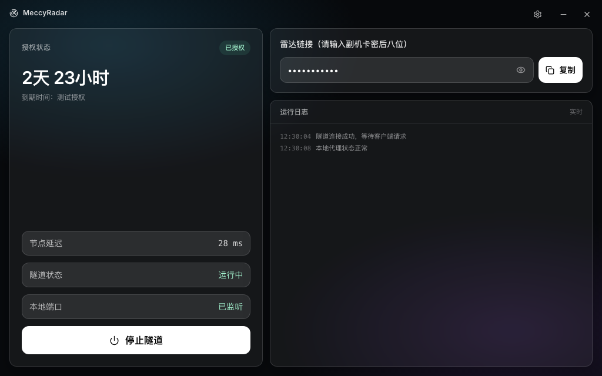

# MeccyRadar

MeccyRadar 是面向用户的 Wails v2 + Go + React/TypeScript 客户端。它不负责创建 FRPS 资源，而是向 RentForge 管理端申请租约、接收 FRP 配置、运行本地隧道，并把雷达分享链接复制给用户。

## 界面预览



截图来自本地开发预览，使用示例数据，不代表真实连接状态。

相关项目：

- **MeccyRadar**：桌面客户端，位于本仓库。
- **RentForge**：服务端管理端，位于相邻的 `rentforge` 仓库，负责卡密、服务器/端口分配、FRPS 面板资源、租约和清理任务。

## 工作流程

1. 客户端使用卡密调用 RentForge 的 `/api/client/login`。
2. RentForge 选择可分配的 FRPS 服务器和端口，创建面板用户，并返回新的租约和 FRP 配置。
3. 客户端启动 FRPC 隧道，周期性调用 `/api/client/heartbeat`。
4. 心跳失败时，客户端只对可恢复的租约失效尝试有限次数的静默重登；被其他设备顶掉或服务端明确要求停止时不会无限互踢。
5. 到期、退出登录或退出程序时，客户端停止隧道并尽量释放租约。

客户端不应硬编码新的服务器地址、端口、Token 或卡密。所有连接信息必须来自 RentForge 的响应。客户端也不直接访问 FRPS Panel；服务器资源创建、端口分配、Token 保存和资源就绪确认全部由 RentForge 完成。

## 服务地址与 Mock

客户端管理端地址来自构建时/运行时配置：`MECCYRADAR_MANAGEMENT_URL`。未设置时使用 `app.go` 中的内置默认 RentForge 地址。生产环境建议显式设置自己的 HTTPS 地址，不要依赖内置默认值。

启动本地 Mock：

```bash
go run ./cmd/mockserver
```

Mock 默认监听 `http://127.0.0.1:18080`。它只模拟鉴权、心跳、租约和基础响应，不会启动真实 FRPS，因此：

- 登录、心跳和租约状态可以用于本地验证；
- 隧道连接不代表真实 FRPS 已可用；
- 使用 Mock 时必须显式覆盖管理端地址：

```bash
export MECCYRADAR_MANAGEMENT_URL=http://127.0.0.1:18080
wails dev
```

Mock 默认测试卡密为 `CARD-1`，但真实卡密不会在 Mock 中生效。不要把生产卡密、Token 或完整分享链接写入日志、截图或提交内容。

真实服务开发：

```bash
unset MECCYRADAR_MANAGEMENT_URL
wails dev
```

如果服务端使用 HTTPS，请确保客户端地址也使用 HTTPS。只有本机 Mock 地址允许明文 HTTP；生产管理端使用明文 HTTP 会暴露卡密和租约 ID。

## 换服务器语义

客户端设置面板中的“更换服务器”调用：

```text
POST /api/client/change-server
```

请求包含当前 `cardKey` 和 active `leaseId`。成功时：

- 自动选择另一台可用服务器；
- 在目标服务器创建新的面板用户、Token 和远程端口；
- 保留原卡密到期时间；
- 释放旧租约并签发新租约；
- 客户端替换内存和磁盘中的 FRP 配置并自动重连；
- 用户必须重新复制最新分享链接，旧服务器/端口链接不应继续使用。

客户端换服有冷却时间。没有可用服务器、目标容量已满、面板不可达或资源分配失败时，服务端会返回明确的业务错误，客户端应显示“请稍后重试”，而不是伪装成换服成功。RentForge 只有在 Panel 的新用户已经出现在读取/鉴权索引后才返回新的 FRP 配置；客户端不负责等待 Panel 同步，也不针对 token 无效做资源创建重试。断网时换服请求不能判为成功；若请求结果不确定，客户端先按服务端权威状态恢复/核对，不会仅凭超时就覆盖现有连接配置。

新资源和本地状态提交成功后，服务端会删除旧服务器用户。如果旧用户删除失败，换服本身仍可能已经成功，但响应会携带 `warning`，并将旧资源写入 cleanup 待办；管理员应通过 RentForge 的 cleanup retry 流程重试删除。

后台管理员的 `migrate_card` 与客户端自助换服不同：管理员指定目标服务器，成功后同样需要删除旧用户；两者都必须保留到期时间，并且都不能在目标资源创建失败时删除旧资源。旧卡记录若没有可证明的历史交付地址，首次登录/迁移会通过实时 Panel 安全核验地址并保守标记链接版本；Panel 不可达或信息不完整时要求联网重试，不以旧 inventory 猜测用户曾收到的链接。

## 离线状态、会话恢复与分享链接提示

客户端离线时版本检查按已持久化的强制更新门禁处理：已知必须更新或本地状态无法安全读取时阻止登录/连接；没有已知强制更新时允许继续使用，但不把联网检查描述为已通过。租约恢复只对明确可恢复的超时/迁移失效尝试有限重登；被其他设备顶替时停止隧道，不自动反复登录。

服务端下发新的链接版本时，客户端会提示用户重新复制最新分享链接。成功复制会确认对应的租约与链接版本；确认状态在进程重启、异步登录恢复和迟到事件间保持一致。剪贴板写入失败会提供可手动选择的链接，不显示为复制成功。换服成功的提示为“已更换服务器，请重新复制最新链接”；客户端不会把换服后的旧链接标记为仍然有效。

## 开发与验证

在仓库根目录运行完整检查：

```bash
make test
make lint
make build
make smoke
```

`make build` 默认构建 Windows amd64 的 `build/meccyradar.exe`，用于在 Windows 真机测试。源码中的唯一默认版本源为 `internal/buildinfo.Version`（`1.0.0`）；正式发行通过 `RELEASE_VERSION` 注入该值，例如 `RELEASE_VERSION=1.2.3 make build`。发行值必须为三段数字稳定版本，否则客户端启动检查会 fail closed。普通开发构建省略该参数即使用 `1.0.0`。macOS 本机构建改用：

```bash
make build-macos
```

前端单独构建：

```bash
npm run build --prefix frontend
```

Windows 交叉编译也可以直接运行：

```bash
make build-windows
```

不要直接使用普通 `GOOS=windows go build` 替代 Wails 构建：Wails 需要正确的 `production` 构建标签，否则 Windows 启动时会弹出“Wails applications will not build without the correct build tags”。

`make smoke` 会检查关键文件、关键 UI 标记以及 `frontend/tests/*.test.mjs`。前端构建通过不等于服务端换服链路已验证；涉及换服的改动还应运行 MeccyRadar 的 Go 测试和 RentForge 的换服/迁移测试。

## 目录

- `frontend/src/App.tsx`：主界面和交互。
- `frontend/src/index.css`：全局样式和 Tailwind token。
- `app_change_server.go`：客户端换服流程。
- `app_lease.go`：租约心跳恢复和异常处理。
- `internal/auth`：RentForge API 客户端与响应契约。
- `internal/diagnosis`：面向用户的错误诊断。
- `docs/ARCHITECTURE.md`：架构和生命周期说明。

## 安全注意事项

- 生产管理端应使用 HTTPS。
- 不要把卡密、FRP Token、租约 ID 或完整分享链接提交到 Git、日志或截图。
- Mock 仅用于本地协议验证，不代表真实服务端和真实 FRPS 的可用性。
- 不要在前端写死生产服务器、Token、远程端口或凭据。
